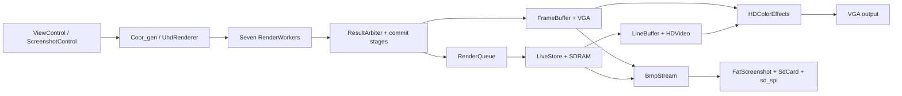

# Architecture

`rtl/Mandel.v` connects the controls, seven shared orbit workers, two display
paths, and screenshot export. Preview, HD, and off-screen 4K rendering use
the same workers.

Preview, HD, and BMP export have separate instances of the color pipeline.
Export uses the settings captured when a screenshot starts.

## Modules

| Area | Modules |
| --- | --- |
| Inputs | `keyboard`, `ViewControl`, `ScreenshotKeys` |
| Coordinates | `Coor_gen`, `UhdRenderer`, `UnsignedDivide` |
| Orbits and sampling | `RenderWorker`, `Engine_fast`, `Engine_interleaved`, `SupersampleColor` |
| Results | `ResultArbiter`, commit registers in `Mandel` |
| Preview | `FrameBuffer`, `VGA` |
| HD storage | `RenderQueue`, `LiveStore`, `io_sdram` |
| HD scanout | `LineBuffer`, `HDVideo` |
| Colors | `ColorMapper`, `EffectPalettes`, `HDColorEffects`, `VideoTimingDelay` |
| Screenshots | `ScreenshotControl`, `BmpStream`, `FatScreenshot`, `SdCard`, `sd_spi` |

The PS/2 receiver synchronizes both input pins, filters short clock pulses,
and discards incomplete bytes or orphaned prefixes after a 20 ms timeout.
`KeyboardRecovery_tb` checks recovery through the view and screenshot controls.

## Clocks

| Domain | Clock | Main users |
| --- | --- | --- |
| Board controls | 50 MHz | PS/2 receiver, buttons, switches, status LEDs |
| Rendering | 75 MHz | Workers, coordinates, preview, SDRAM, SD export |
| HD video | 108 MHz | HD raster, line buffers, HD effects |
| SDRAM pins | 75 MHz, half-cycle phase shift | Forwarded clock and read capture |

`RenderClocks` derives the render and HD clocks from `CLOCK_50`. Reset release
is synchronized after PLL lock. Preview enables a pixel every three render
clocks; HD consumes one pixel per video clock.

HD line requests cross domains using a held address and request/acknowledgement
handshake. The controller writes the unused line buffer while video reads
the other. A Gray-coded progress counter marks completed groups. Display
selection changes at frame boundaries; sync has its own delay path.
`Mandel.sdc` constrains the clocks, SDRAM pins, and asynchronous inputs.

## Rendering and storage

Preview renders 640 x 480 at 511 iterations. HD and 4K permit up to 32,767
iterations per sample. All modes use Q8.24 coordinates, which limit zoom detail.

The engines compare exact orbit states against checkpoints in windows up to
256 steps. Repeating states terminate interior orbits without changing their
fixed-point result. Longer cycles continue to the iteration limit.

HD and 4K first sample two opposite corners. Matching color indices from
escapes below 32 iterations use two samples; other pixels use four. Identical
sample coordinates also use two. This shortcut can miss detail between corners.

Four eight-pixel groups can be in flight. Workers finish out of order, while
`RenderQueue` publishes complete groups in raster order. Backpressure stops
dispatch when the queue fills. Completion waits for workers, commit stages,
queued groups, and SDRAM writes to drain.

Eight RGB444 pixels occupy three 32-bit SDRAM words. The HD image starts at
byte zero and occupies 1,966,080 bytes. The 4K image starts at byte 4,194,304
and occupies 12,441,600 bytes. Scanline reads have priority over uploads,
exports, and SW7 edits.

See [renderer details](renderer.md) and [SD screenshots](sd-screenshots.md).
